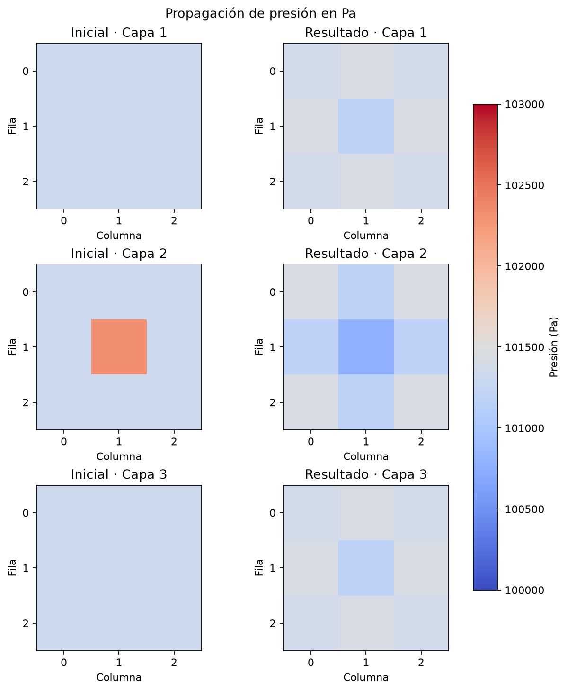
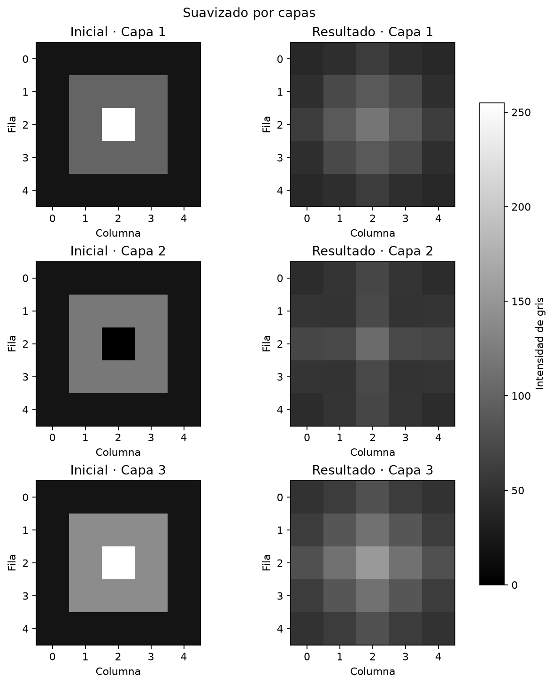
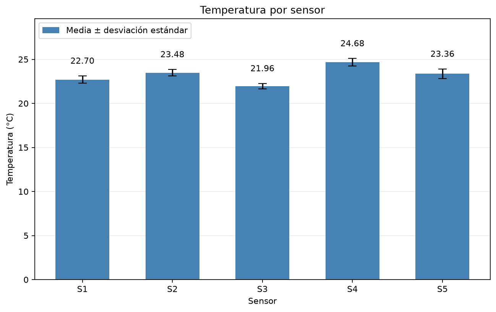
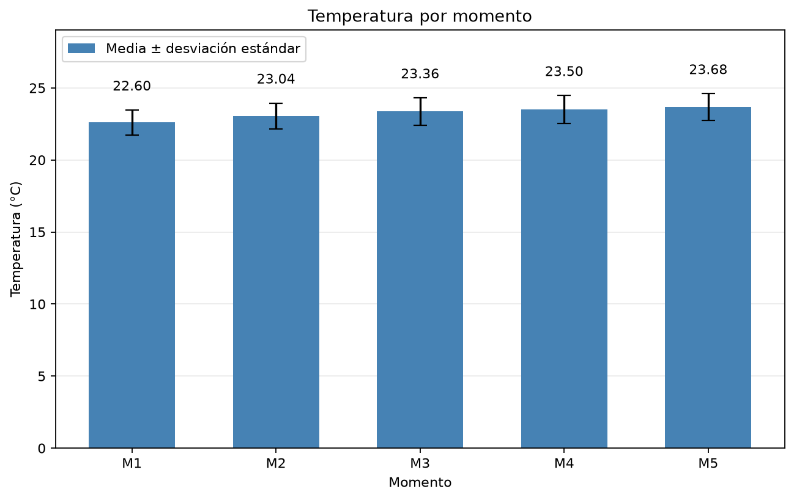
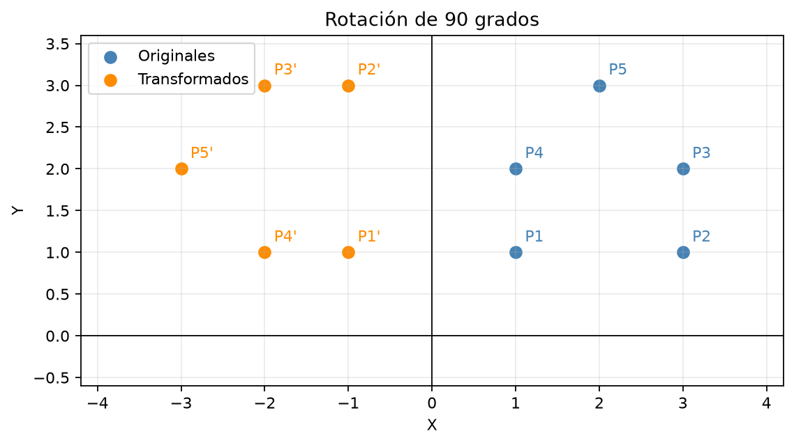

# C9T1 Aplicaciones prácticas de arreglos multidimensionales en ingeniería

Los cinco ejercicios utilizan listas anidadas para organizar fuerzas, un fluido, imágenes por capas, temperaturas y coordenadas, recorriendo filas, columnas y capas mediante funciones y utilizando Matplotlib para dibujar los resultados.

## Clonar y ejecutar

```bash
git clone https://github.com/matezepam/c9t1-aplicaciones-practicas-de-arreglos-multidimensionales-en-ingenieria.git
cd c9t1-aplicaciones-practicas-de-arreglos-multidimensionales-en-ingenieria
python -m venv .venv
source .venv/bin/activate
python -m pip install -r REQUISITOS.txt
python "EJECUTAR TODO.py"
```

Cada ejercicio también puede ejecutarse por separado con el entorno activado.

```bash
python "PROBLEMA 1 FUERZAS.py"
python "PROBLEMA 2 FLUIDO.py"
python "PROBLEMA 3 IMAGENES MEDICAS.py"
python "PROBLEMA 4 SENSORES.py"
python "PROBLEMA 5 COORDENADAS.py"
```

Los cálculos aparecen en la terminal y las cinco gráficas se guardan como PNG en `RESULTADOS`, reemplazándose al ejecutar otra vez el ejercicio correspondiente y pudiendo abrirse con el visor de imágenes o consultarse directamente en este README.

`APOYO.py` debe permanecer junto a los ejercicios porque reúne la comprobación de dimensiones, la impresión de matrices y las gráficas, dejando los cálculos en los archivos de cada problema y evitando repetir esas funciones.

## Representación de los datos

Una matriz se consulta como `matriz[fila][columna]` y un volumen como `volumen[capa][fila][columna]`, con índices desde cero y filas y capas creadas de forma independiente para que modificar una posición no cambie otras por compartir la misma lista.

Las listas de Python almacenan referencias a objetos y pueden cambiar de tamaño, por lo que las listas anidadas representan las dimensiones mediante índices y no necesitan que todos los valores del volumen estén en un único bloque contiguo de memoria.

## PROBLEMA 1 Fuerzas en una estructura

La matriz de 3 × 3 contiene cargas verticales en una placa rígida con nodos separados un metro, tomando cargas positivas hacia abajo y reacciones positivas hacia arriba, con tres apoyos en A `[0][0]`, B `[0][2]` y C `[2][0]` porque el enunciado no especifica sus posiciones.

`calcular_reacciones` acumula cargas y momentos en un recorrido y obtiene las reacciones de B y C dividiendo los momentos entre sus distancias a A, calculando después la reacción de A mediante el equilibrio vertical y guardando cero en los nodos que no son apoyos.

`comprobar_equilibrio` verifica fuerzas y momentos y obtiene residuos iguales a cero para el ejemplo, cuyas reacciones son 105 N en A, 325 N en B y 280 N en C, conservando la matriz original y utilizando sólo acumulados y una matriz de salida.

El modelo calcula equilibrio y no deformaciones ni esfuerzos internos y, si otra distribución produce una reacción negativa, ese apoyo necesitaría un anclaje capaz de ejercer fuerza hacia abajo.

## PROBLEMA 2 Fluido en una cuadrícula 3D

El volumen de 3 × 3 × 3 contiene 27 celdas con presión en Pa, temperatura en °C y componentes de velocidad en m/s, comenzando con presión ambiente de 101325 Pa y una perturbación de 1000 Pa en la celda central.

`crear_fluido` construye celdas independientes y `extraer_presiones` obtiene la matriz numérica necesaria para recordar el paso anterior, mientras `propagar_un_paso` calcula la presión siguiente a partir de los seis vecinos directos y actualiza la velocidad con las diferencias de presión entre lados opuestos.

```text
presión siguiente = 2 × presión actual − presión anterior
                    + coeficiente × (suma de vecinos − 6 × presión actual)
```

El coeficiente es `(rapidez × tiempo / separación)²` y se limita a un tercio para esta cuadrícula, utilizando 340 m/s, 0.001 s y 1 m en el ejemplo y presión ambiente fija fuera del volumen para tratar los bordes.

`simular_fluido` repite los pasos sin mezclar estados de distintos instantes y conserva sólo los necesarios para avanzar, con tiempo proporcional a pasos por celdas y memoria proporcional al tamaño del volumen, mientras la temperatura permanece en 20 °C porque esta aproximación acústica no calcula intercambio térmico ni viscosidad.

La gráfica compara las tres capas iniciales y las obtenidas después de cuatro pasos con la misma escala de presión.



## PROBLEMA 3 Suavizado de imágenes por capas

El volumen contiene tres imágenes sintéticas de 5 × 5 con intensidades entre cero y 255 y valores aislados que simulan ruido, permitiendo observar el filtro sin utilizar imágenes reales de pacientes.

`promedio_vecinos` calcula la media de una ventana de 3 × 3 dentro de la misma capa y utiliza sólo posiciones existentes en los bordes, mientras `suavizar_volumen` construye una salida nueva para no leer vecinos que ya hayan sido modificados durante el recorrido.

El centro de la primera capa pasa de 255 a 117.22 aproximadamente y se reduce el pico aislado, aunque el promedio también suaviza los contornos y no garantiza conservar todos los detalles.

Cada posición considera como máximo nueve valores y el trabajo aumenta con las celdas del volumen, reservando una salida del mismo tamaño y manteniendo una escala común de gris para comparar las imágenes.



## PROBLEMA 4 Tabla de sensores

La tabla de 5 × 5 organiza momentos en las filas y sensores en las columnas, de acuerdo con la indicación del análisis por filas y columnas y haciendo que `tabla[0][1]` represente el segundo sensor en el primer momento.

`promedio_y_desviacion` devuelve media y desviación estándar poblacional y `analizar_sensores` reutiliza esa función en los dos sentidos de la tabla, obteniendo cuatro listas sin modificar las mediciones y dividiendo la varianza entre la cantidad de valores porque se describe el conjunto observado.

El primer sensor tiene una media de 22.700 °C y una desviación de aproximadamente 0.420 °C y los recorridos requieren trabajo proporcional a filas por columnas, con una columna temporal y las listas de resultados como almacenamiento adicional.

Las barras muestran los promedios y las líneas negras una desviación estándar hacia cada lado de la media.





## PROBLEMA 5 Transformación de coordenadas

Cada fila de la matriz contiene las coordenadas x e y de un punto y `crear_matriz_rotacion` obtiene una transformación de 2 × 2 a partir de un ángulo en grados, usando el origen como centro y sentido positivo contrario a las agujas del reloj.

`transformar_puntos` multiplica cada punto por la matriz y devuelve coordenadas nuevas para conservar el conjunto original, con una rotación de 90 grados que convierte `(1, 1)` en `(-1, 1)` y `(3, 2)` en `(-2, 3)`.

El trabajo aumenta con la cantidad de puntos porque cada uno requiere cuatro multiplicaciones y dos sumas y la memoria adicional corresponde al conjunto transformado, mostrando ambos sobre ejes con igual escala para observar la rotación y la conservación de distancias al origen.


